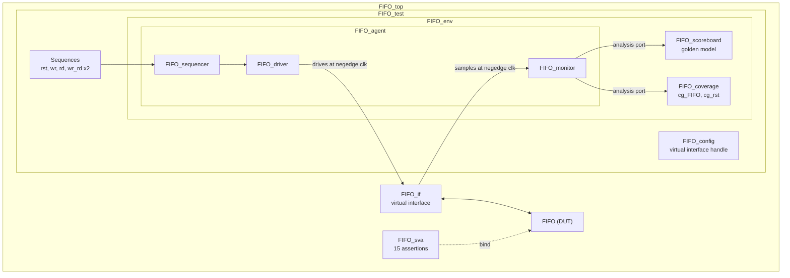

<div align="center">

# Synchronous FIFO Verification with SystemVerilog and UVM

**A complete UVM verification environment for a parameterizable synchronous FIFO: constrained-random stimulus, a cycle-accurate golden model, functional coverage and SystemVerilog Assertions.**


</div>

---

## At a Glance

| | |
|:---|:---|
| **Transactions checked** | 2,301, all matching the golden model (0 mismatches) |
| **Functional coverage** | 100%: `cg_FIFO` 68/68 bins, `cg_rst` 4/4 bins |
| **DUT code coverage** | 100%: statements 29/29, branches 27/27, conditions 20/20, toggle 106/106 |
| **Assertions** | 15, each with a cover directive (9 deferred immediate, 6 concurrent) |
| **Verification plan** | 27 requirements traced to stimulus, coverage and checks |
| **RTL bugs found and fixed** | 5 |

---

## The Design Under Test

A single-clock synchronous FIFO with an asynchronous active-low reset.

| Parameter | Value |
|:---|:---|
| `FIFO_WIDTH` | 16 bits |
| `FIFO_DEPTH` | 8 entries |

| Inputs | Outputs |
|:---|:---|
| `clk`, `rst_n`, `wr_en`, `rd_en`, `data_in` | `data_out`, `wr_ack`, `overflow`, `underflow` (registered) |
| | `full`, `empty`, `almostfull`, `almostempty` (combinational) |

Behaviour worth verifying:

- A write when full is rejected and raises `overflow`. A read when empty is rejected and raises `underflow`.
- `wr_ptr` and `rd_ptr` wrap from `FIFO_DEPTH - 1` back to 0.
- With `wr_en` and `rd_en` together, both succeed when the FIFO is neither full nor empty. When full only the read happens, and when empty only the write happens.
- The flags follow `count`: `full` at 8, `empty` at 0, `almostfull` at 7, `almostempty` at 1.

---

## Testbench Architecture



| Component | Role |
|:---|:---|
| `FIFO_top` | Generates the clock, instantiates the interface and DUT, binds the assertions, stores the virtual interface in `uvm_config_db` and calls `run_test` |
| `FIFO_if` | Groups all DUT pins plus the internal `mem`, `wr_ptr`, `rd_ptr` and `count` signals that the assertions check |
| `FIFO_test` | Builds the environment and runs the five sequences in order under one objection |
| `FIFO_config` | Carries the virtual interface handle to the agent, driver and monitor |
| `FIFO_seq_item` | Transaction with the random stimulus fields, the response fields and the constraints |
| `FIFO_sequencer` / `FIFO_driver` | Pass each item to the driver, which applies it to the pins at `negedge clk` |
| `FIFO_monitor` | Samples the four inputs and eight outputs at `negedge clk` and publishes one item per cycle |
| `FIFO_scoreboard` | Golden reference model that compares all eight outputs for every transaction |
| `FIFO_coverage` | Functional coverage groups and crosses |
| `FIFO_sva` | Assertions bound into the DUT |

---

## How a Transaction Flows

1. A sequence randomizes a `FIFO_seq_item` and hands it to the sequencer.
2. The driver applies `data_in`, `rst_n`, `wr_en` and `rd_en` to the interface and holds them until the falling clock edge.
3. The DUT samples the inputs on the rising edge and updates its outputs. The bound assertions evaluate alongside it.
4. On the falling edge the monitor samples the inputs together with the outputs they produced and sends the item through its analysis port.
5. The scoreboard runs its golden model and compares the outputs. The coverage collector samples its covergroups.
6. After the last sequence the test drops its objection and the scoreboard prints the correct and failed counts.

---

## Stimulus

Constraints in `FIFO_seq_item`:

| Field | Constraint |
|:---|:---|
| `rst_n` | `dist {1 := 98, 0 := 2}`: reset hits at random in every sequence |
| `wr_en` | `dist {1 := 70, 0 := 30}` (weight from `shared_pkg`) |
| `rd_en` | `dist {1 := 30, 0 := 70}` (weight from `shared_pkg`) |
| `data_in` | unconstrained 16-bit random |

Sequences, run in this order by `FIFO_test`:

| # | Sequence | Items | Purpose |
|:-:|:---|:-:|:---|
| 1 | `FIFO_rst_seq` | 1 | Start from a known reset state |
| 2 | `FIFO_wr_seq` | 100 | Write phase: fill the FIFO and keep writing after full |
| 3 | `FIFO_rd_seq` | 100 | Read phase: drain the FIFO and keep reading after empty |
| 4 | `FIFO_wr_rd_seq2` | 100 | Write and read together in every cycle |
| 5 | `FIFO_wr_rd_seq1` | 2,000 | 100 x (10 writes then 10 reads): count sweeps up and down, pointers wrap |

---

## Checking

### Golden model (scoreboard)

The scoreboard keeps its own memory, pointers and count and mirrors the specified behaviour: reset, write only, read only, and write plus read (with the full and empty special cases). For every transaction it compares `data_out`, `wr_ack`, `overflow`, `underflow`, `full`, `empty`, `almostfull` and `almostempty` with `!==`, and counts matches and mismatches.

### Assertions (`FIFO_sva`)

Signals that do not wait for a clock edge (the asynchronous reset behaviour and the combinational flags) are checked in an `always_comb` block with **deferred immediate assertions** (`assert final`), which evaluate at the final settled value of the time step. Clocked behaviour uses **concurrent assertions**.

| Type | Assertions |
|:---|:---|
| Immediate (`assert final`) | `reset_flags`, `RST_wr_ptr`, `RST_rd_ptr`, `RST_count`, `async_reset_seq` |
| Immediate (`assert final`) | `empty_flag`, `full_flag`, `almost_full`, `almost_empty` |
| Concurrent | `write_ack`, `overflow_detection`, `underflow_detection` |
| Concurrent | `wr_wraparound`, `rd_wraparound`, `threshold` |

The assertions are enabled by compiling with `+define+SIM`.

---

## Functional Coverage

- **`cg_FIFO`** has 9 coverpoints (`wr_en`, `rd_en`, `full`, `almostfull`, `empty`, `almostempty`, `overflow`, `underflow`, `wr_ack`) and 7 crosses: `cross_full`, `cross_almost_full`, `cross_empty` and `cross_almost_empty` (each `wr_en` x `rd_en` x flag), plus `cross_overflow`, `cross_underflow` and `cross_wr_ack`. Impossible bins are excluded with `ignore_bins`.
- **`cg_rst`** covers `rst_n` asserted, deasserted, and both edges.
- The flags in a monitored item are the values after the clock edge, so the collector crosses the inputs with the previous cycle's flags. That is the state the inputs were applied in.

---

## Verification Plan

The plan has 27 items, each mapped to stimulus, coverage and a check (an assertion type or the golden model).

| Group | Items | What is verified |
|:---|:---|:---|
| Reset | FIFO_1 to FIFO_3 | Pointers, counter, sequential outputs and flags after reset |
| Write and read | FIFO_4 to FIFO_7 | Accepted and rejected operations, `wr_ack`, overflow, underflow |
| Flags | FIFO_8 to FIFO_11 | `empty`, `full`, `almostfull`, `almostempty` against `count` |
| Simultaneous access | FIFO_12 to FIFO_14 | Write and read together in normal, empty and full states |
| Pointers and bounds | FIFO_15 to FIFO_17 | Wraparound and pointer and counter limits |
| UVM flow | FIFO_18, FIFO_19 | Driving and sampling timing, end of test |
| Scenario sequences | FIFO_20 to FIFO_27 | Fill, drain, continuous simultaneous access, alternating bursts, reset during operation, data integrity, idle cycles, rejected operations |

---

## Bugs Found in the RTL

| # | Bug | Fix |
|:-:|:---|:---|
| 1 | `wr_ack` and `overflow` were missing from the `rst_n` branch | Cleared in the reset branch |
| 2 | The `full && wr_en` condition used `&` instead of `&&` | Logical `&&` |
| 3 | `underflow` was combinational | Registered in the read block |
| 4 | `almostfull` compared `count` with `FIFO_DEPTH - 2` | Compares with `FIFO_DEPTH - 1` |
| 5 | Simultaneous write and read was not handled | Added the full, empty and normal cases for `count` |

---

## Repository Structure

```text
.
├── FIFO.sv                 DUT
├── FIFO_if.sv              interface
├── FIFO_top.sv             top module
├── shared_pkg.sv           parameters and constraint weights
├── FIFO_sva.sv             assertions
├── FIFO_config.sv          configuration object
├── FIFO_seq_item.sv        transaction and constraints
├── FIFO_rst_seq.sv         reset sequence
├── FIFO_wr_seq.sv          write sequence
├── FIFO_rd_seq.sv          read sequence
├── FIFO_wr_rd_seq.sv       simultaneous and alternating sequences
├── FIFO_sequencer.sv
├── FIFO_driver.sv
├── FIFO_monitor.sv
├── FIFO_agent.sv
├── FIFO_scoreboard.sv      golden model
├── FIFO_coverage.sv        functional coverage
├── FIFO_env.sv
├── FIFO_test.sv
├── src_files.list          compile list
└── run.do                  compile, simulate and save coverage
```

---

## Running the Simulation

Requires Siemens QuestaSim with UVM 1.2.

```bash
vsim -do run.do
```

`run.do` compiles the files in `src_files.list` with coverage and `+define+SIM` (so the assertions are active), runs the simulation, and saves the coverage database. Coverage can then be reported with `vcover report`.

---

## Tech Stack

- **Languages:** SystemVerilog, UVM 1.2, SVA
- **Methodology:** constrained-random verification, scoreboard-based self-checking, functional coverage modelling, assertion-based verification
- **Simulator:** Siemens QuestaSim

---

## Author

**Haneen Fady Shahin**

This project is open for learning, educational use and experimentation. Feel free to study the design, modify it, or use it as a reference for similar academic projects.
